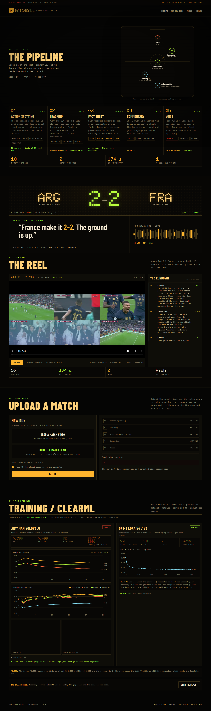

# Matchcall

AI play-by-play commentary over real football footage. Drop in a broadcast MP4,
get back the same clip with an energetic commentator dubbed on top — or a
10-second-per-moment commented highlights reel.

```
video ─▶ action spotting (score-bug OCR + motion-gated window scan)
      ─▶ YOLO26n + ByteTrack + team/possession facts
      ─▶ deterministic fact sheet
      ─▶ GPT-2 LoRA commentary (validator + grounded template safety net)
      ─▶ Fish Audio s2.1-pro-free / edge-tts
      ─▶ commented highlights reel
```

Events detected: **goal, shot, tackle, pass, corner, dead_time**.



*The live Stadium Board UI: pipeline → ARG–FRA match board → API-Football feed → upload/match plan → training.*

- **Project report:** [`docs/Matchcall_Project_Report.docx`](docs/Matchcall_Project_Report.docx)
- **Research sample:** [`docs/Matchcall_sample_v3.docx`](docs/Matchcall_sample_v3.docx)
- **Presentation runbook:** [`docs/presentation_runbook.md`](docs/presentation_runbook.md)
- **Code walkthrough:** [`docs/code_walkthrough.md`](docs/code_walkthrough.md)

## Web demo

The current UI is the Stadium Board: pipeline, ARG–FRA match board, API-Football
feed, upload/match plan, then training/ClearML.

```powershell
.venv\Scripts\python -m uvicorn app.webapp:app --host 127.0.0.1 --port 8100
# open http://127.0.0.1:8100
```

The upload accepts a video and a match-plan document. JSON plans are parsed in
the browser for teams, venue, score, minute, players and positions; the backend
plan parser is the next implementation step.

## Commented highlights (the 5-stage pipeline)

```powershell
# ARG-FRA 2022 second half; score is 2-0 at t=0 and the broadcast clock is 34:38
.venv\Scripts\python scripts\make_commented_highlights.py `
  --video "path\to\ARG-FRA.mp4" `
  --home Argentina --away France `
  --start-score-home 2 --start-score-away 0 --minute-offset 35.33
```

Outputs in `output/commented_highlights/`:

| file | what |
|---|---|
| `commented_highlights.mp4` | the reel (10 s per selected moment) |
| `annotated_goal.mp4` | tracking overlay (players, teams, ball, IDs) |
| `highlights.json` | moments, score anchors, descriptions, commentary, timings |
| `transcript.txt` | minute-by-minute commentary lines |
| `score_anchors.json` | score-bug goal evidence |

Stages map to the code:

1. **Action spotting** — `app/vision/score_flip.py` (score-bug digit-shape
   transitions with a verified per-feed cache) and `app/vision/analyze.py`
   (motion-gated YOLO window scan plus a weak-supervised ResNet-18 classifier).
2. **Tracking / visual enrichment** — `app/vision/fv_tracker.py` uses YOLO26n
   with ultralytics ByteTrack, KMeans jersey-colour teams and ball possession.
3. **Action description** — grounded facts (team, minute, score, possession,
   ball zone, tracked players) built in `scripts/make_commented_highlights.py`.
4. **Textual commentary** — `app/commentary_gpt2.py` (LoRA) with a validator
   that rejects invented teams, scores, cards or player names; a grounded
   template is the safety net.
5. **Audio commentary** — `app/tts.py` (Fish Audio `s2.1-pro-free` when
   `FISH_API_KEY` is real, edge-tts otherwise).

### Score-bug calibration

The reader is calibrated for the 1920x1080 beIN score bug. Boxes live in
`app/vision/score_flip.py`; they scale with the frame. If you change
broadcaster, update `BEIN_1080_BOXES` and `BEIN_1080_CLOCK`. The score already
on the board at `t0` must be passed with `--start-score-home/away`; the
official match-minute at `t0` with `--minute-offset` (ARG-FRA: 35.33, i.e. the
80' goal lands at video 2687 s).

For the ARG-FRA demo, `output/commented_highlights/score_anchors.json` is a
**verified cache** (2687 s = 80', 2784 s = 81') and the script reuses it. The
automatic reader is best-effort on this font; the cache is the calibrated
answer for this feed.

### GPT-2 LoRA

`models/gpt2_lora_v4/` is trained on team-grounded SoccerReplay-1988 commentary
with completion-only loss. `models/gpt2_lora_v5/` uses the API-slot prompt and
adds the goal-decode guardrails (beam search, contradiction/score suppression,
and a validator that checks both colon and hyphen scores). Retrain with:

```powershell
.venv\Scripts\python scripts\build_commentary_corpus.py
.venv\Scripts\python scripts\train_commentator_lora.py `
  --data data\commentator_train_v4.jsonl --out models\gpt2_lora_v4 --epochs 3
```

### Fish Audio

Put a real key in `.env`:

```
FISH_API_KEY=<your-key>
FISH_MODEL=s2.1-pro-free
FISH_VOICE_ID=40f53434437e46a5bcbb5abb39f5079c
```

`***` is treated as missing; the pipeline falls back to edge-tts and says so.
As soon as the key is set, re-run the reel to re-voice every line with
`s2.1-pro-free` — no other change.

## YOLO26n detector (product model)

The current detector is **YOLO26n**, fine-tuned on the V1 football export
(8,677 train / 2,996 val; Player, Ball, Referee):

```powershell
.venv\Scripts\python scripts\train_yolo26.py --epochs 50 --imgsz 640 --batch 16 --clearml
```

- Base: `weights/yolo26n.pt`
- Output: `models/yolo26/yolo26n_v1_640/weights/best.pt`
- ClearML: project **Football Commentator**, task **Aryaman YOLO26n football
  detector — V1 fine-tune**, metrics/plots + registered output model
- Set `FC_DETECTOR_WEIGHTS=models\yolo26\yolo26n_v1_640\weights\best.pt` to use
  it for uploads; otherwise the default detector path is used.
- The older YOLOv5lu run is kept only as a descriptive comparison; the two runs
  did not receive equal epochs or parameter budgets.

## Full-match dub

```powershell
.venv\Scripts\python -m app.cli --video "match.mp4" --home Argentina --away France `
  --score-home 2 --score-away 0 --minute-offset 35.33
```

The whole-match action-spotting pass uses the configured detector. Set
`FC_DETECTOR_WEIGHTS` to the YOLO26n checkpoint for the current model; the
highlights script uses the same detector for the 10-second clip tracking.


## Setup (Windows, CUDA GPU)

```powershell
py -3.11 -m venv .venv
.venv\Scripts\pip install -r app\requirements.txt
copy .env.example .env        # add FISH_API_KEY for Fish Audio
```

Requires `ffmpeg`/`ffprobe` on PATH. YOLO26n weights are expected at
`weights/yolo26n.pt` for training and at
`models/yolo26/yolo26n_v1_640/weights/best.pt` for inference.

## Train the detector

Dataset: football-players detection set (Roboflow CC-BY mirror), 8,677 train /
2,996 test images with Player / Ball / Referee boxes. The zip is expected at
`data/V1.zip` and extracts to `data/V1/`.

```powershell
.venv\Scripts\python scripts\train_yolo26.py --epochs 50 --imgsz 640 --batch 16 --clearml
```

Weights land at `models/yolo26/yolo26n_v1_640/weights/best.pt`; point
`FC_DETECTOR_WEIGHTS` at that file for the live pipeline.

## Commentary writers

`app/commentary.py` uses the fine-tuned GPT-2 LoRA adapters and a deterministic
validator:

1. **GPT-2 v4** — LoRA r=32, completion-only loss, trained on team-grounded
   SoccerReplay commentary.
2. **GPT-2 v5** — API-slot adapter (`<HOME>`, `<AWAY>`, `<TEAM>`, `<PLAYER>`,
   `<SCORE>`, `<MINUTE>`) for API-Football and upload facts.
3. **Grounded template** — the last-resort safety net when every candidate
   fails validation.

The validator checks team names, blocked names, digits/scores, event words and
goal contradictions. It is a guard against invented facts, not a measure of
fluency. See `app/commentary_gpt2.py`.

## Web UI

```powershell
.venv\Scripts\python -m uvicorn app.webapp:app --host 127.0.0.1 --port 8100
# open http://127.0.0.1:8100 — pipeline, ARG–FRA board, API feed, upload, training
```

Jobs run in a single background worker (`POST /api/upload`,
`GET /api/job/{id}`, `POST /api/job/{id}/cancel`). The upload accepts a video
and a match-plan document; JSON plans are parsed in the browser for teams,
venue, score, minute, players and positions.

## Run

```powershell
# second half of the ARG-FRA match, from minute 15, 2-minute clip
.venv\Scripts\python -m app.cli --video "match.mp4" --home Argentina --away France --t0 900 --duration 120
```

Output directory contains:

| file | what |
|---|---|
| `final_commentary.mp4` | the dubbed clip |
| `transcript.txt` / `.json` | every line with timestamp + event tag |
| `analysis.json` | per-window vision features, labels, ResNet probs |
| `tts/` | per-segment voice lines (for QA) |

On GPU the whole 2-minute clip processes in well under a minute; even CPU-only
runs ~0.6× realtime.

## Design notes

- **Motion-gated sampling** (`app/vision/sampling.py`): one fast ffmpeg pass
  extracts a 480px/4fps proxy; frame-diff motion decides which frames the
  detector sees (dead time sampled sparsely). This is what makes the pipeline
  faster than realtime.
- **Weak supervision** (`app/vision/auto_label.py`): windows are auto-labeled
  by documented heuristics (ball in goalmouth + sustained presence → goal,
  speed spike → shot, motion spike + speed dip + crowd → tackle). ResNet-18 is
  trained on those weak labels and is **advisory**: it can promote a quiet pass
  to shot/goal only with converging evidence; it never overrides the score-bug
  anchor.
- **No dead air** (`app/filler.py`): a filler engine inserts rotating ambient
  lines whenever narration gaps would exceed ~20s, so the commentary track is
  continuous.
- **Audio bed**: original broadcast audio is kept at low volume (0.12) under
  the commentator for atmosphere — disable with `--no-orig-audio`.
- **Language + voice**: GPT-2 v4/v5 → validator → Fish Audio; a grounded
  template is the safety net, and edge-tts is the TTS fallback if Fish fails.
